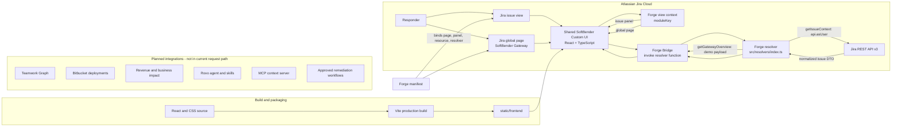

# SoftBender

[](LICENSE)
[](https://developer.atlassian.com/platform/forge/)
[](https://nodejs.org/)

**Incident context, where the work already happens.** SoftBender is a Jira Cloud app and Codegeist 2026 project taking a context-first approach to SRE response. Its first delivered capability is a fast, read-only issue brief in Jira; the longer-term direction is to connect operational changes to business impact and safe remediation.

> **Current status:** The codebase includes a Jira issue panel and global page, a read-only Rovo risk agent/skill, and native `rovo:mcp` tools. Risk analysis reads Teamwork Graph-indexed Bitbucket pull requests and optional Jira issue signals, and can retrieve current-user team memberships from Teamwork Graph. The global page's incident overview remains demo data. Revenue exposure and automated remediation are not implemented. Deploy and upgrade the Jira installation to publish manifest changes.

## Why SoftBender

Incident responders lose time moving between tickets, deployments, service ownership, and business-impact tools. SoftBender starts inside the Jira issue and brings its essential operational context into one compact panel. The design is intentionally permission-aware and read-only today: it requests only the fields the panel needs and uses the viewing user's Jira access.

## What Works Today

Open the SoftBender issue panel on a Jira issue to see:

- Issue key and summary
- Status, issue type, and priority
- Assignee and last-updated time
- Loading, unavailable, rate-limited, and retry states

After deploying and upgrading the Jira installation, open **SoftBender Gateway** from Jira navigation to see an incident overview, related deployment, and connected-context list. This overview is demonstration data and is labeled as such in the UI.

The issue panel fetches context when opened and offers a manual refresh. Neither surface polls or persists issue data. The current app does not change Jira issues or call the Bitbucket REST API; PR context is read from Teamwork Graph using the invoking user's access.

## System Architecture



### Request lifecycle

1. Jira opens either the issue panel or the global page and supplies Forge view context.
2. The shared UI checks `moduleKey` to select the matching experience.
3. The issue panel invokes `getIssueContext`; the global page invokes `getGatewayOverview` through `@forge/bridge`.
4. `getIssueContext` validates the issue key and calls Jira REST API v3 with `api.asUser()`. `getGatewayOverview` returns a typed demonstration payload and makes no external API request.
5. The UI renders live issue details or an explicitly labeled demo overview, with recoverable loading and error states.

## Security and Permissions

- Jira API calls run as the current user; SoftBender does not elevate issue access.
- Issue keys are taken from Forge extension context, checked for a non-empty string, and encoded with Forge's `route` helper.
- The resolver requests a fixed list of Jira fields rather than returning the full issue payload.
- Jira authorization failures and unavailable issues are presented without exposing response bodies.
- All configured scopes are read-only and site-scoped: `read:jira-work`, `read:graph:pull-request:external`, `read:graph:user:atlassian`, and `read:graph:team:atlassian`. Bitbucket workspace scopes are intentionally excluded because Forge does not allow workspace scopes to be combined with Jira site scopes in one app.
- No issue data is stored by this feature.

## Performance and Resilience

- One Jira request is made when the panel loads, with a manual refresh instead of background polling.
- The API request limits its response to the fields displayed in the panel.
- Vite emits production assets with hashed filenames and relative asset paths for the Forge Custom UI resource.
- The panel handles Jira rate limiting (`429`), permission or missing-issue responses (`401`, `403`, `404`), other HTTP failures, malformed responses, and network errors.
- Retries are user initiated through the refresh control; the app does not currently run automatic retry or backoff logic.

## Technology

| Area | Technology |
| --- | --- |
| App platform | Atlassian Forge |
| Runtime | Node.js 22.x |
| Frontend | React, TypeScript, Tailwind CSS 4, Vite |
| Forge UI integration | `@forge/bridge` |
| Backend | Forge resolver and `@forge/api` |
| Current product surfaces | Jira Cloud issue panel and global page |

## Repository Layout

```text
.
├── manifest.yml              # Forge modules, resource, runtime, and scopes
├── package.json              # Build and typecheck scripts
├── package-lock.json         # Reproducible npm dependency graph
├── tsconfig.json             # Strict TypeScript configuration
├── vite.config.ts            # Builds Custom UI into static/frontend
├── src/
│   ├── index.ts              # Forge resolver handler entry point
│   ├── resolvers/index.ts    # Jira issue-context resolver
│   └── frontend/
│       ├── index.html
│       ├── main.tsx          # Issue panel, global page, and state routing
│       └── styles.css
└── static/frontend/          # Built Forge Custom UI resource
```

## Requirements

- Node.js 22.x
- npm
- Atlassian Forge CLI
- An Atlassian account with a Jira Cloud site where you can install Forge apps

## Get Started

Clone the repository and install the locked dependencies:

```sh
git clone https://github.com/Bright-star-cell/SoftBender.git
cd SoftBender
npm ci
```

Authenticate the Forge CLI and check the app:

```sh
forge login
npm run typecheck
npm run build
forge lint
```

Deploy to the development environment:

```sh
forge deploy
```

For a first install, follow the CLI prompts or specify your Jira site and product:

```sh
forge install --site your-site.atlassian.net --product jira --environment development
```

After changing code, run `npm run typecheck`, `npm run build`, and `forge lint`, then deploy again. If a future change adds or removes scopes, upgrade the existing installation so the site receives the updated consent requirements:

```sh
forge install --upgrade --site your-site.atlassian.net --product jira --environment development
```

Replace `your-site.atlassian.net` with a site you administer. Forge deployment and installation require an authenticated CLI session and the appropriate site permissions.

## Development Commands

| Command | Purpose |
| --- | --- |
| `npm ci` | Install the exact versions in `package-lock.json` |
| `npm run typecheck` | Run strict TypeScript checking without emitting files |
| `npm run build` | Build the frontend into `static/frontend` |
| `forge lint` | Validate the Forge manifest and app configuration |
| `forge deploy` | Package and deploy to the selected Forge environment |

The Forge backend bundler must be able to emit TypeScript output. Keep `noEmit` off in the root `tsconfig.json`; the dedicated typecheck script passes `--noEmit` itself.

## Troubleshooting

### `TypeScript emitted no output`

Check that the root `tsconfig.json` does not set `"noEmit": true`. Forge's TypeScript bundler needs emitted output; `npm run typecheck` already disables emission through its command-line flag.

### `Not logged in`

Forge CLI authentication is local to the shell environment. Run `forge login` in the same terminal where you run `forge lint` or `forge deploy`, then retry.

### The panel says the issue is unavailable

Confirm that the signed-in Jira user can view the issue and that the app has been installed in the expected site and environment. The panel intentionally gives the same user-facing message for authorization failures and missing issues.

### Jira is rate limiting requests

Wait briefly and use the panel's refresh button. Automatic retries are not implemented.

## Roadmap

These are intended directions, not implemented or enabled features:

- Teamwork Graph traversal across work, goals, decisions, and outcomes beyond current-user team membership
- Correlation discovery between Bitbucket pull requests and Jira issues, beyond user-supplied issue keys
- Revenue exposure and business-impact estimation
- Human-reviewed remediation proposals and auditable execution controls

## Rovo and MCP

The Forge `rovo:agent`, `rovo:skill`, and `rovo:mcp` modules register the SoftBender Risk Sentinel, its skill instructions, and read-only action tools for incident status, deployment risk, and current-user team membership. `rovo:mcp` is Atlassian's hosted integration for Rovo Studio and compatible MCP clients; this app does not expose a custom unauthenticated JSON-RPC endpoint.

The operational risk score is an explainable heuristic based on Teamwork Graph pull request status and, when supplied, Jira priority/status. It is not a revenue-risk calculation. Teamwork Graph access also returns the invoking user's Atlassian team memberships and does not establish a pull-request or service ownership relationship.

## Marketplace Submission

The Forge manifest and npm package include an app description, module names/descriptions, module icons, repository, license, and support links. Marketplace listing categories, screenshots, contact details, privacy policy, and the listing's square app icon are managed in the Atlassian Marketplace Partner Portal; Forge manifest schema does not expose those listing fields. Complete them there before submitting the listing.

Each integration should add value without weakening least-privilege access, data boundaries, or responder control.

## Contributing

Issues and pull requests are welcome. Keep changes scoped, preserve strict TypeScript checking, and verify frontend changes with `npm run typecheck` and `npm run build`. Validate Forge configuration with `forge lint` before submitting deployment-related changes.

## License

SoftBender is licensed under the [MIT License](LICENSE).
